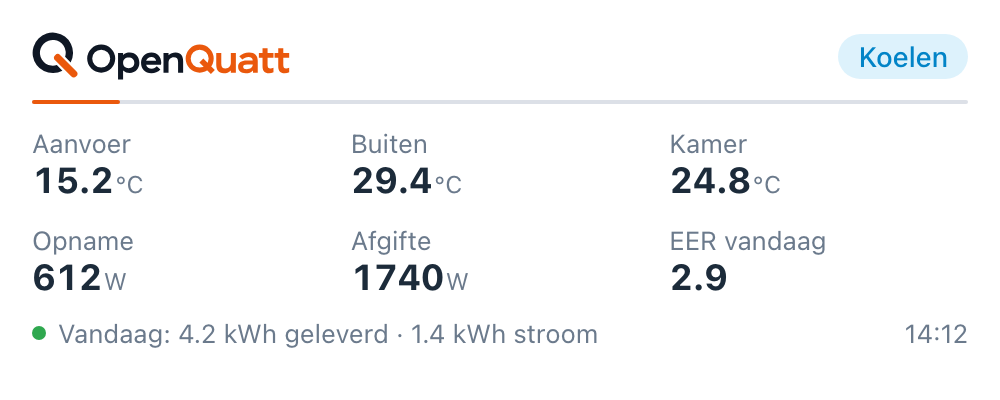
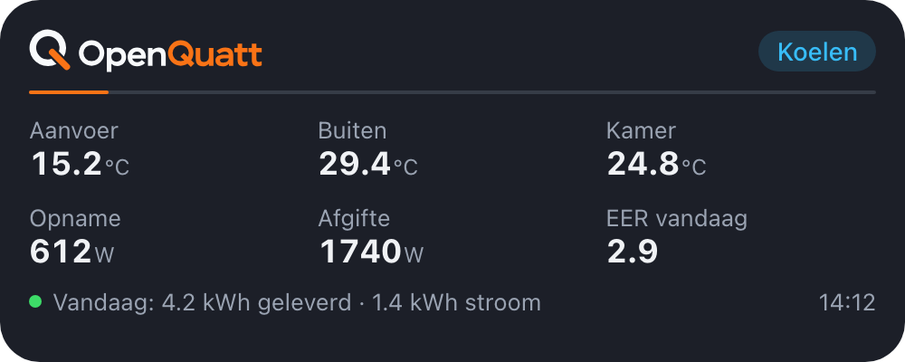
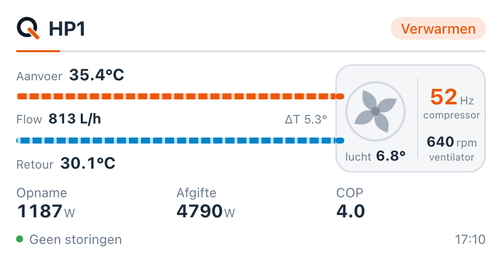
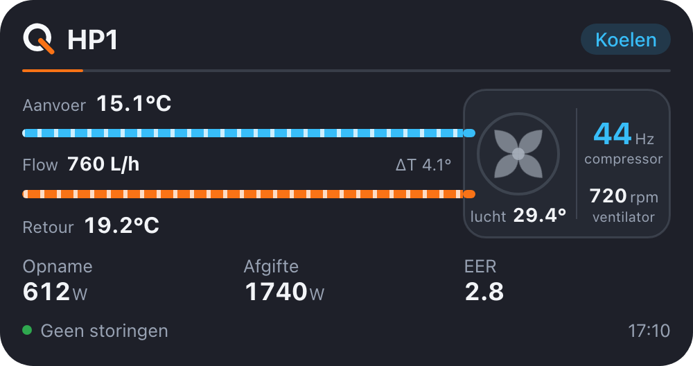
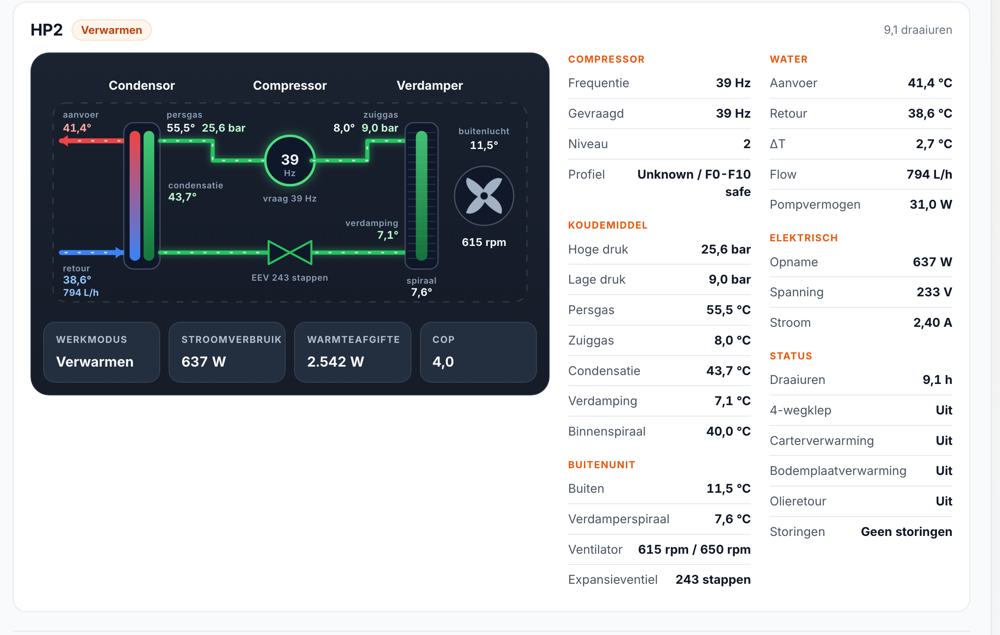
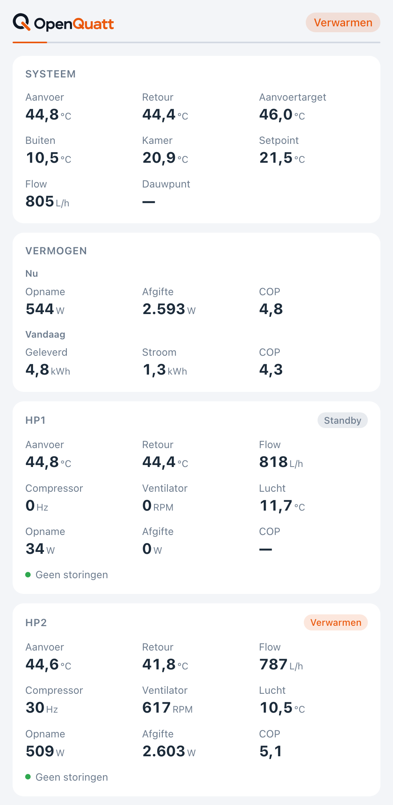

<p align="center">
  <picture>
    <source media="(prefers-color-scheme: dark)" srcset=".github/openquatt-logo-dark.svg">
    
  </picture>
</p>

<h1 align="center">OpenQuatt for Homey</h1>

<p align="center">
  Monitor and control your <a href="https://github.com/OpenQuatt/OpenQuatt">OpenQuatt</a> heat pump controller from Homey Pro — fully local, real-time, zero cloud.
</p>

<p align="center">
  
  
  
  
</p>

---

## ✨ Features

### Device

Pair your Heatpump Controller Q-edition in seconds — it is discovered automatically on your network via mDNS (with a manual IP override if you need it).

| Capability | Source |
|---|---|
| Supply / outside / room temperature | live, pushed by the controller |
| Return temperature (HP1 water inlet) | live |
| Supply target (heating curve) | live, the target the heating curve control steers to |
| Room setpoint (as selected by the controller) | live |
| Dew point (as selected by the controller) | live |
| Power in, heat output, cooling output | live |
| COP and EER | live |
| Water flow | live, in L/h |
| Control mode (CM0…CM100) | live, as label and as a number for Insights |
| Compressor frequency and running hours, per outdoor unit | live |
| Compressor starts over 2 and 24 hours, per outdoor unit | read from the controller every five minutes |
| Heating and cooling permission | live |
| Heating permission source picker | all six firmware sources, switchable from Homey |
| Room temperature source picker | OpenTherm thermostat, CIC, Home Assistant, API input or MQTT, switchable from Homey |
| Heating strategy picker | Power House or the heating curve, switchable from Homey |
| Extended heating (Power House) | a toggle plus pickers for the stop margin and the cooling after stopping, read back from the controller |
| Aux relay (R2) function picker | all five firmware modes, switchable from Homey |
| Aux relay status | live status text from the control loop |
| OpenQuatt control, manual cooling enable & R2 relay toggles | direct control |

The device is a heat pump in Homey, so you pick which of these values its tile shows as **status indicator**: a temperature, the power, the COP, the flow and so on (device settings → *Status indicator*).

Every number and switch above is a capability, so Homey logs it in **Insights** — the control mode included, charted as its bare CM code next to the readable label. The per-unit figures show how each compressor runs and cycles; HP2's appear once the controller reports HP2, so only on a duo installation. Room humidity is the one thing that is missing: OpenQuatt itself has no room humidity value, it only works with the dew point, so chart the humidity sensor in Homey instead.

Set a login on the controller? Fill in the same username and password under *Controller login* in the device settings. The controller then asks for it on every request, the live stream included, and the device tells you when it rejects the login.

### Flow cards

- **Triggers** — control mode changed (with mode token), heating started/stopped, cooling started/stopped, a fault was detected/resolved (with fault description token), defrosting started/stopped (per heat pump), boiler turned on/off, silent mode turned on/off, the dew point became available / was lost, the water flow changed (with flow token), the water flow rose above / dropped below a value you choose
- **Conditions** — is heating, is cooling, a fault is active, is defrosting, the boiler is active, silent mode is active, aux relay function is …, the heating permission source is …, the room temperature source is …, the heating strategy is …, a dew point is available, cooling is permitted, the water flow is above a value you choose
- **Actions** — set manual cooling enable, force control mode (standby / circulate / anti-freeze / automatic), set silent mode override, set boiler assist, set OpenQuatt control on/off, set aux relay function, set the aux relay temperature hysteresis, switch the R2 relay (external control mode), send a dew point to the controller, update the dew point for a room from temperature + humidity, send the outside temperature / room temperature / room setpoint, send a supply target, hand the supply target back to the heating curve, send a heating curve offset, set the heating permission source, set the room temperature source, set the heating strategy, set extended heating (Power House), set the heating permission, set the cooling permission

### Dew point & cooling safety

OpenQuatt only cools when it knows the indoor dew point: the supply water must stay above it (plus a safety margin), or condensation would form on your floor and pipes. This app can feed that dew point straight from the sensors you already have in Homey — the same role the Home Assistant dynamic-cooling package plays, including the identical Magnus formula and highest-room-wins aggregation.

On firmware with [API input support](https://github.com/OpenQuatt/OpenQuatt/blob/main/docs/api-input.md) this needs **zero configuration**: the app posts the dew point directly to the controller's API input over the local connection it already uses. Just add the flows:

- For each room you cool: *when* temperature or humidity of the room sensor changes → *then* **Update the dew point for [room] from temperature and humidity**, using the sensor tags. Rooms are aggregated with highest-wins, values expire automatically (configurable, 60 min default), and the last aggregate is re-sent every minute so the controller's 15-minute staleness check keeps passing.
- Already have a computed dew point? Use the simpler **Send dew point to the controller** card instead.

On older firmware without the API input, MQTT works as fallback: enable *MQTT input sources* in the OpenQuatt web app (*Settings → Sources / integrations*), point it at a broker on your network, and fill in the same broker under *External values — MQTT fallback* on the OpenQuatt device in Homey. The [MQTT Server](https://homey.app/a/net.weejewel.mqttserver/) app turns your Homey Pro itself into that broker — use the username and password from its app settings on both sides, as it does not accept anonymous connections.

The device also shows the dew point the controller actually selected, and the *dew point available / lost* triggers plus the *cooling is permitted* condition let you alert on a broken sensor before a hot day does it for you.

### Feeding the controller from Homey

The dew point is not the only source value the controller accepts from outside. Each of these has its own flow card, and takes the same route: straight to the controller's API input, with MQTT as fallback:

| Flow card | Range | Kept alive |
|---|---|---|
| Send the outside temperature to the controller | -40…60 °C | until your flow stops refreshing it |
| Send the room temperature to the controller | 0…50 °C | until your flow stops refreshing it |
| Send the room setpoint to the controller | 5…35 °C | until you send a new value |
| Send a supply target to the controller | 20…70 °C | until you send a new value or hand it back to the heating curve |
| Send the heating curve offset to the controller | −5…+5 °C | until you send a new value |
| Set heating permission (on/off) | — | until you send a new value |
| Set cooling permission (on/off) | — | until you send a new value |

The app re-sends everything it feeds every minute, so the controller's validity windows (10 to 30 minutes, depending on the signal) never expire underneath you. Measurements stop being sent once the flow behind them goes quiet for longer than *Maximum sensor value age* (60 minutes by default) — the controller then falls back to its own source, rather than steering on a value from this morning. The setpoint, the supply target, the heating curve offset and the two permissions are commands rather than measurements: they stand until you send a new value. The setpoint and the permissions are also re-asserted after an app restart. The supply target and the offset are not: after a restart the controller lets them lapse once their 15-minute validity window has passed, back to its own heating curve and to a 0 °C offset. Send 0 °C to clear the offset immediately.

The cooling permission is the regular permission signal, so the controller weighs it against the source you picked. *Set manual cooling enable* is a different card for a different thing: OpenQuatt's manual override, which permits cooling regardless of the selected source.

One thing to set on the controller side: in the OpenQuatt web app under *Settings → Sources / integrations → Sensor selection*, the signal has to be allowed to use API input (or MQTT) as its source — `Auto` covers that for most of them.

The heating permission only counts while the controller takes it from *API input* (or *MQTT*). You set that from Homey itself, with the picker on the device or the *Set the heating permission source* card. *Not used* is the other useful choice. It is not "heating off": it drops the permission gate, so the heating strategy decides by itself when heat is needed, and a thermostat that switches its heat demand on and off no longer starts and stops the heat pump.

The room temperature source picker and the *Set the room temperature source* card choose where the controller reads the room temperature, for example *API input* to use another sensor in Homey with the *Send the room temperature to the controller* card. Power House stops heating while that source has no fresh value, and the app stops re-sending a value after the maximum age in the device settings, so keep a flow feeding it. The room setpoint keeps its own source.

The heating strategy picker and the *Set the heating strategy* card switch between Power House and the heating curve, which the web app calls *Water Temperature Control*. They send that one select and nothing else. The heating permission source, the curve points and the Power House settings stay as they were, so switching back gives you the curve exactly as you left it. The card waits until the controller reports the new strategy and fails if that takes more than 15 seconds. The firmware resets the strategies' runtime state on every switch, so asking for the strategy that already runs sends nothing.

The *Set extended heating (Power House)* card turns on the firmware's run extension and sets its two thresholds. It matters when the house needs less heat than one compressor delivers at its minimum, which makes Power House stop as soon as the room reaches the setpoint. With extended heating on, a running heat pump keeps heating at its minimum output up to the setpoint plus the stop margin. It heats again once the room has cooled the chosen amount below that stop temperature, but no lower than Power House's normal start point. A wider band means fewer and longer runs: setpoint 20, stop margin 1.0 and cooling 1.1 heat from 19.9 to 21.0. The card writes the two thresholds before the switch and leaves the strategy and the heating permission source alone. The device shows the same three settings as a toggle and two pickers, so you can also change them there and see what the controller actually uses.

For the heating curve offset, explicitly select *API input* or *MQTT* under *Heating curve offset* in the OpenQuatt web app. It adjusts the local heating curve and does not replace the supply target.

The supply target goes further: it replaces the heating curve's own target, room correction included, for as long as it stands, and takes priority over the offset. Use it when something else already knows how warm the water should be, such as a buffer tank flow. The controller's water temperature limits, its PID and the heat pump control stay its own. Select *API input* or *MQTT* under *Supply target (heating curve)* in the OpenQuatt web app; the default, *Heating curve*, ignores it. There is no neutral value to clear it with, so *Hand the supply target back to the heating curve* stops sending it instead: the controller returns to its curve once the last value has expired, within 15 minutes. The *Supply target (heating curve)* value on the device shows the target the control actually steers to, whichever of the two it is.

### Dashboard widgets

**OpenQuatt status** — a branded, glanceable status card for your phone:

<p align="center">
  
  
</p>

- Mode badge that follows the controller: standby, heating, cooling, anti-freeze, offline
- Six live stats: supply / outside / room temperature, power in, thermal power out, today's COP (or EER while cooling)
- Smart status line: **active faults** (heat pump failures, low-flow protection, flow mismatch, OpenTherm link issues) take priority in red; otherwise today's delivered energy and consumption

**OpenQuatt heat pump** — one outdoor unit up close, a compact take on the heat pump view in the OpenQuatt web app:

<p align="center">
  
  
</p>

- A live scheme of the unit: supply and return temperature on pipes that flow while water moves, the water flow and ΔT, a fan that spins at the unit's own fan speed, the compressor frequency and the outside air at the unit
- The unit's working mode as a badge (standby, heating, cooling, defrosting) with a snowflake while it defrosts
- Power in, heat or cooling output, and the COP (or the EER while cooling) of this unit alone
- The unit's own active failures in red
- Pick HP1 or HP2 in the widget settings; on a duo installation, place one of each

### Remote access

Away from home, you can still look at the controller: a read-only page in the style of the OpenQuatt web app, refreshed every five seconds.

- **Overview** — key figures, system status, the heating curve with its supply target, the temperatures, and both outdoor units with fans that turn at their real speed, their running hours and recent compressor starts
- **Heat pumps** — the compressor starts per unit over 2, 6, 24 and 72 hours against the alarm limits, and each unit's refrigerant circuit live: water through the condenser, compressor, expansion valve and evaporator, with pressures and temperatures, and every unit detail next to it
- **Energy** — power now, today and since the start, and the controller's energy history per day, week or month, with the average COP and how much heat came from the outside air
- **Trends** — the last 24 hours of water temperatures, comfort, power and compressors, as five-minute averages your Homey keeps
- **All values** — everything the controller reports, searchable

<p align="center">
  
</p>
<p align="center">
  
</p>

It is off by default. To switch it on:

1. Fill in a username and password under *Controller login* in the device settings; remote access needs a password of at least 8 characters. Has the controller a login of its own, use that one. If not, the login only guards the remote page. (A first login on the controller itself is set through its physical recovery button, see the OpenQuatt docs.)
2. Tick *View the controller from outside the home* under *Remote access*.
3. Open the address shown under *Page* there and sign in with that login. The address holds your Homey's ID, so the page knows which Homey to ask.

The page lives in this repository (`docs/remote`, served by GitHub Pages) and calls public endpoints of the app through your Homey's cloud connection, `https://<homey-id>.connect.athom.com/api/app/nl.openquatt/remote/…`. Public means Homey asks for no Homey account, so the app guards them itself:

- Signing in checks the login in constant time and hands out a random session token, so the password is not sent again. The page keeps the token in the browser and stays signed in.
- After 10 failed sign-ins within 15 minutes, every sign-in is refused until the window has passed. Pages that are already signed in keep working.
- A session ends after 30 days without use, when the app restarts, when you sign out, and as soon as you switch remote access off or change the password.
- The endpoints only read: nothing on the page can switch or change the controller. Each tab asks only for the values it shows, and the controller's energy history is cached for two minutes, so paging through periods does not load the ESP. The compressor start counters are kept off the controller's event stream; the app reads them through its bulk entity endpoint while the page shows them, at most once a minute.

This is the only part of the app that goes through the cloud, and only while it is switched on.

## 🔌 How it works

The app talks to the ESPHome web server that OpenQuatt already runs on port 80 — the same interface the OpenQuatt web app uses:

- **State**: one persistent Server-Sent Events stream on `GET /events`. Every entity state arrives on connect and is pushed on every change — real-time, no polling.
- **Commands**: the REST routes, addressed by URL-encoded display name (`POST /switch/Manual%20Cooling%20Enable/turn_on`). These also reach `internal: true` entities such as the aux relay configuration.
- **Login**: when one is set on the controller, every request carries it as HTTP Basic auth, the way the controller checks it.

Unlike the Home Assistant integration (which uses the ESPHome native API on port 6053), no API encryption key or pairing window is needed. The load on the ESP equals a single open browser tab of the web UI, and there are **zero runtime npm dependencies**.

## 🚀 Installation

Until the app is published in the Homey App Store, install it in developer mode:

```bash
git clone https://github.com/OpenQuatt/homey-openquatt.git
cd homey-openquatt
npm i -g homey     # Athom CLI (once)
homey login
homey app install  # or `homey app run` for live development
```

Requires a **Homey Pro (2023 or newer)** — widgets and local apps need firmware ≥ 12.3.0.

Don't have the hardware yet? The ready-made [Heatpump Controller Q-edition](https://electropaultje.nl/product/heatpump-controller-q-edition/) is available at Electropaultje.

## 🛠 Development

```bash
homey app validate   # manifest + assets check
homey app run        # live install with log streaming and widget hot-reload
```

- Entity → capability wiring lives in `drivers/openquatt/device.js` (`ENTITY_CAPABILITIES`); widget-only telemetry in `TELEMETRY_ENTITIES`, and the per-unit values of the heat pump widget in `HEATPUMP_ENTITIES`.
- The transport is `lib/OpenQuattClient.js` — a native-API transport could be added later behind the same interface.
- `.homeycompose/` is the source of truth; `app.json` is generated by the CLI.
- Keep the connection count low: OpenQuatt is heap-constrained on the ESP32. One persistent SSE client is fine; several are not.

## 🙏 Credits

- **[OpenQuatt](https://github.com/OpenQuatt/OpenQuatt)** — the open firmware for Quatt heat pumps that makes all of this possible. Built by **jj85** ([jeroen85](https://github.com/jeroen85)), **[leejoow](https://github.com/leejoow)** and the OpenQuatt community.
- **[Electropaultje](https://electropaultje.nl/product/heatpump-controller-q-edition/)** — the ready-made Heatpump Controller Q-edition hardware, purpose-built for OpenQuatt.
- Questions or experiences to share? Join the [OpenQuatt topic on the Tweakers forum](https://gathering.tweakers.net/forum/list_messages/2325776).
- The OpenQuatt name and logo are used with kind permission of the OpenQuatt maintainer.
- This app is a community project and is not affiliated with Quatt B.V.

## 📄 License

[MIT](LICENSE) — the OpenQuatt name and logo remain property of the OpenQuatt project.
